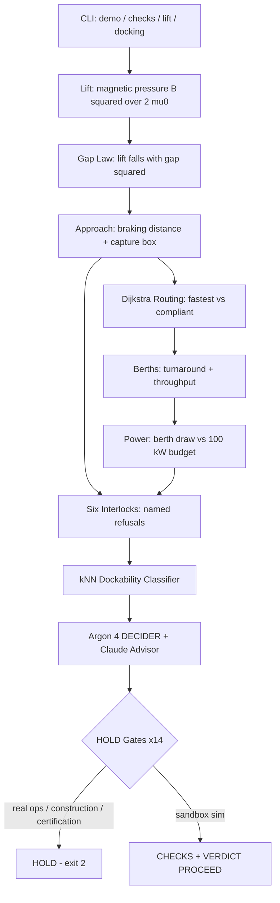
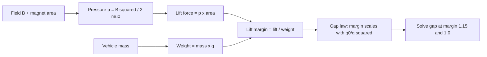
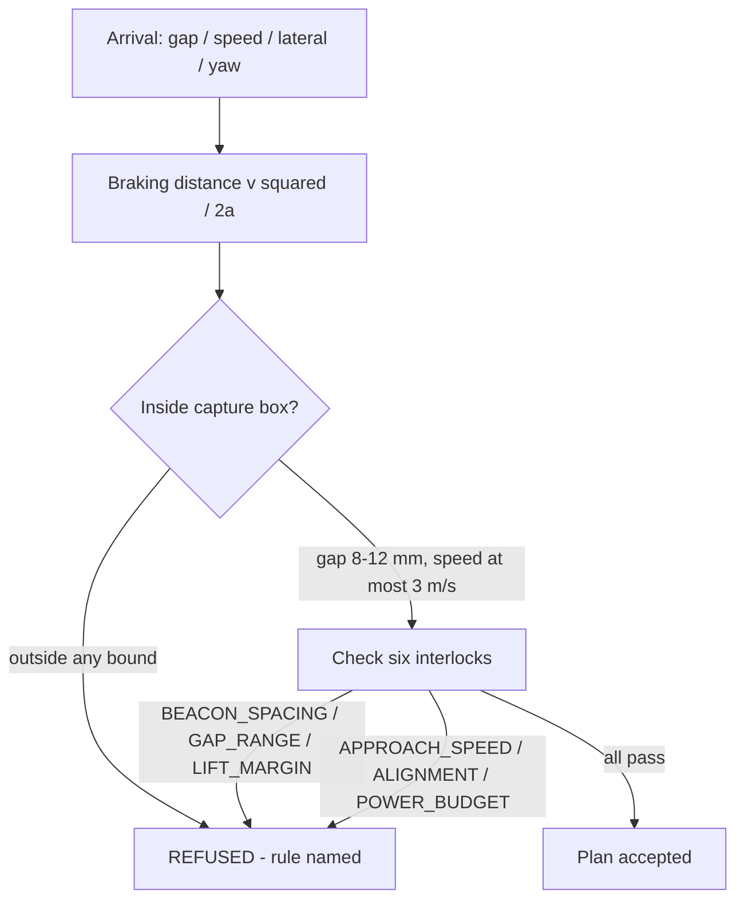
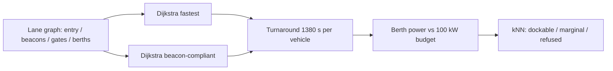
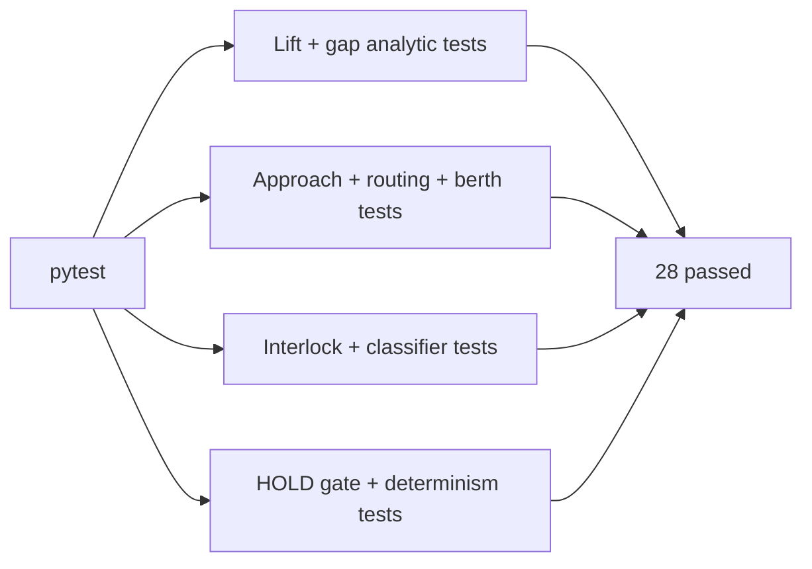
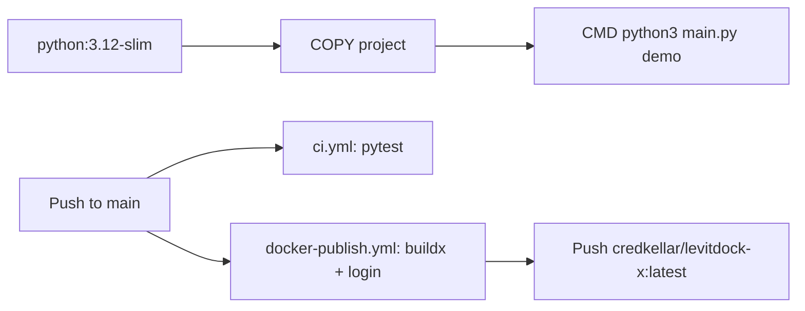

# LevitDock-X 🛸🧲

**Levitation Docking Station Lab** — by Darion Kellar

LevitDock-X is an **educational levitation docking station lab** in ONE pure-Python file. The other labs in this family move vehicles — LevitationX floats them, HoverX flies them low, MagLevX runs them on a guideway. LevitDock-X is where they **arrive**: a station that has to catch a floating vehicle, align it, and berth it **without it ever touching the guideway**. 🛸

That arrival is four honest problems wearing one coat:

- **The lift is magnetic pressure** — `p = B² / (2μ₀)`, and it falls with the **square of the air gap**, so a few millimetres of drift is the difference between floating and falling. 🧲
- **The approach is a braking-distance problem** — come in too fast and the stopping distance runs past the capture point. 🛑
- **The berth is a turnaround problem** — dock, unload, charge, load, undock: 23 minutes a vehicle, and the station's throughput is arithmetic. ⏱️
- **The dock is a power-budget problem** — a 100 kW supply, four vehicles drawing 92.0 kW, and a fifth one refused by name. 🔌

A deterministic lane graph is routed with Dijkstra, and six interlocks **REFUSE** a docking plan — beacon spacing, gap range, lift margin, approach speed, alignment, power budget — with the violated rule named.

Honest scope, stated up front: this is a **planning and learning simulator** — it docks nothing real and guides no real vehicle. Real maglev systems (Shanghai Maglev, JR SCMaglev L0, Incheon Airport Maglev) are **labelled published facts, never computed results**. Every real-world construction / operation / certification action sits behind a permanent HOLD gate (14 total). 🔒

[](https://github.com/kimanicollier44-cmyk/LevitDock-X/actions/workflows/ci.yml)
[](https://github.com/kimanicollier44-cmyk/LevitDock-X/actions/workflows/docker-publish.yml)

> ℹ️ These are the **live** workflow badges for this repo. They activate as soon as the `ci.yml` and `docker-publish.yml` files from the paste pack are pasted into `.github/workflows/` — until then they have nothing to report yet.

## 🧰 Tech Stack Badges & Full Architecture Tech Stack

### 💻 Core Programming Languages & Core Systems


- 🐍 Python 3.12, pure standard library (`math`, `heapq`, `hashlib`, `json`, `sys`) — zero dependencies, zero network, deterministic (double-run byte-identical)
- 🧲 Lift physics core: magnetic pressure `p = B² / (2μ₀)`, lift force = pressure × magnet area, weight = mass × g, and the gap law `(g₀/g)²` — every formula asserted against its analytic value in CHECKS
- 🗺️ From-scratch Dijkstra over the approach-lane graph (`heapq`), run twice per report: fastest vs beacon-compliant
- 🧠 TinyML kNN dockability classifier (from scratch, stdlib): dockable / marginal / refused from gap + lateral offset + approach speed
- 🪑 Council seats: Gemini Argon 4 DECIDER (names-only, tighten-only) + Muse advisor (never overrides HOLD) + Google Flow plan-only (rendered = False, live = 0)

### ⛓️ Web3 & Infrastructure

- 🚫 **Not applicable — honestly.** No blockchain, no Web3, no tokens: the "infrastructure" in this lab is a labelled simulation of a docking station — its lanes, beacons, berths, and power supply — inside one offline file. No fake badges here.

### ⚙️ Platform Support & Hardware Architecture


- 🖥️ Pure Python — runs anywhere Python 3.12+ runs (Linux, macOS, Windows), plus the `python:3.12-slim` Docker image
- 🔒 No hardware is controlled, ever: real vehicles, guideways, docks, and berths are permanent HOLD gates (see the gate table below)

### ⚡ Low-Level Infrastructure & Performance

- 🚫 **No low-level code — honestly.** No C, no C++, no GPU, no compiled extensions: this is one interpreted Python file on purpose, so every number can be read, checked, and diffed. Performance here means honest algorithms — the closed-form gap solver for the 1.15-interlock gap, Dijkstra with a binary heap, fixed labelled constants — all deterministic and byte-identical between runs.

### 🛠️ DevOps & Build Tools


- 🐳 Docker (`python:3.12-slim`), GitHub Actions CI + Docker Publish (delivered in the paste pack)
- 🎯 Target image: `credkellar/levitdock-x:latest`
- 🧪 Tests: `pytest` (28 tests) + the built-in CHECKS suite (78 checks) in `main.py`

### ☁️ Cloud Providers

- 🚫 **None — honestly.** No cloud provider is used or needed: the lab runs fully offline on your own machine or in a local Docker container. Docker Hub appears only as the registry the publish workflow pushes the image to.

## What this does?

1. 🧲 **Levitation lift — magnetic pressure does the lifting** — `p = B² / (2μ₀)`: at 1 T the pressure is **~398 kPa**, and lift = pressure × magnet area. The pod (8 t, 1.0 T, 0.30 m²) lifts **119,366 N** against **78,453 N** of weight — a lift margin of **1.52**. The rest of the fleet: taxi **1.64**, shuttle **1.43**, cargo **1.46**.
2. 📏 **The gap is the lift** — lift falls with `(g₀/g)²`, so the gap *is* the safety case: at a **15 mm** gap the pod's margin is **0.68** — below weight, the vehicle falls. The gap at which the margin hits the **1.15 interlock** is **11.50 mm**; at margin 1.0 it is 12.33 mm. Both gaps are solved, not guessed.
3. 🛑 **Docking approach — a braking-distance problem** — stopping distance `v² / (2a)` at 1.2 m/s²: **3 m/s needs 3.75 m**, but **5 m/s needs 10.42 m** — already past the capture point. Arrive fast and there is physically nowhere left to stop.
4. 🎯 **The capture box** — a docking only counts inside the box: gap **8–12 mm**, speed **≤ 3 m/s**, lateral offset **≤ 0.25 m**, yaw **≤ 2°**. Outside any one of the four, the capture fails — the box is checked as a box, not as a vibe.
5. 🏷️ **Labelled references** — Shanghai Maglev (30.5 km, 430 km/h, 2004), JR SCMaglev L0 (42.8 km test line, 500 km/h, test-line record 603 km/h in 2015), Incheon Airport Maglev (6.1 km, 110 km/h, 2016). Published facts, printed for scale — never computed results.
6. 🗺️ **Dijkstra routing over the lane graph** — entry, beacons, junction, gates, berths: the fastest ENTRY → BERTH_2 run is **187.5 s over 1,650 m** via the 900 m express lane; the compliant route (no segment over 500 m without a beacon) is **200.0 s over 1,450 m**. The 12.5 s is what the beacon rule costs, priced in the open.
7. ⏱️ **Berths & turnaround** — one turnaround is **1,380 s (23 min)**: dock 90 s, unload 300 s, charge 600 s, load 300 s, undock 90 s. One berth turns **2.61 vehicles/h**; four berths turn **10.43/h — ~188 per 18-hour day**.
8. 🔌 **The dock is a power budget** — four berthed vehicles draw **92.0 kW of the 100 kW** supply, leaving 8 kW of headroom. A fifth cargo lifter tips the dock over budget — so the budget, not the brochure, decides the fleet size.
9. 🚫 **Six interlocks REFUSE plans, by name** — `BEACON_SPACING` (the express lane is refused), `GAP_RANGE` + `LIFT_MARGIN` (a 14 mm capture is refused twice over), `APPROACH_SPEED` (5 m/s refused), `ALIGNMENT` (0.60 m / 4° refused), `POWER_BUDGET` (a 152.5 kW fleet refused). Every refusal names the rule it broke.
10. 🏷️ **Classifier + seats + checks** — a from-scratch kNN labels arrivals dockable / marginal / refused (nominal pod: dockable; tight-gap taxi: dockable; edge-gap shuttle: marginal; fast-in pod: refused; wide misaligned cargo: refused), with Argon 4 DECIDER (sha256 trace), Muse advisor, Google Flow plan-only, and a built-in CHECKS suite (78 checks).

## 🗺️ How it works — diagram per script

### `main.py` — the whole lab



### `main.py` — lift & gap physics



### `main.py` — approach, capture box & interlocks



### `main.py` — routing, berths, power & classifier



### `tests/test_main.py` — verification



### `conftest.py` — test path setup


### `Dockerfile` + CI flow — container & publish



## Why is this cool?

1. 🧲 The lift is **one formula with a receipt**: `p = B² / (2μ₀)` turns 1 tesla into ~398 kPa, and the pod's 1.52 margin is that pressure times an area, divided by a weight — no hand-waving anywhere in the chain.
2. 📏 The gap law is brutal and honest: widen the gap from 10 mm to 15 mm and the margin collapses from 1.52 to **0.68** — the lab shows a floating vehicle *falling* out of its own spec, in numbers.
3. 🎯 The interlock gap is **solved, not picked**: 11.50 mm is where the margin crosses 1.15, computed from the physics — the safety limit has a derivation, not a marketing department.
4. 🛑 Speed kills the docking, arithmetically: 5 m/s needs 10.42 m to stop and the capture point is closer than that — the refusal is geometry, not policy.
5. 🗺️ Safety has a price tag and the lab prints it: the beacon-compliant route costs exactly **12.5 s** over the fastest one (200.0 s vs 187.5 s), so the rule and its cost sit on the same page.
6. ⏱️ A whole station's day is one turnaround repeated: 23 minutes per vehicle × 4 berths = **~188 vehicles per 18-hour day** — throughput as arithmetic you can audit.
7. 🔌 The power budget bites: 92.0 kW of 100 kW with four vehicles berthed, and the fifth is refused *by name* (`POWER_BUDGET`) — capacity planning as an interlock, not a surprise outage.
8. 🚫 Refusals are **named, not silent**: six interlocks, each printing the rule it enforced — a 14 mm capture gets refused twice over (`GAP_RANGE` + `LIFT_MARGIN`) and the plan book shows both.
9. 🏷️ Real maglevs appear as what they are: Shanghai, SCMaglev, and Incheon are **labelled published facts** next to the model, so scale is honest and nothing real is claimed as computed.
10. 🎯 Deterministic end to end: run it twice, get byte-identical output — a docking station you can diff.

## What problems this solves?

1. ❌ **Problem:** "Levitation" gets explained as magic magnets with no force budget. ✅ **Solution:** Magnetic pressure, lift force, and weight are computed per vehicle; the margin *is* the explanation (pod 1.52, taxi 1.64, shuttle 1.43, cargo 1.46).
2. ❌ **Problem:** The air gap is treated as a detail, when it is the whole safety case. ✅ **Solution:** The `(g₀/g)²` law is front and centre, with the fall at 15 mm (margin 0.68) and the solved interlock gap (11.50 mm) printed.
3. ❌ **Problem:** Docking concepts ignore stopping distance. ✅ **Solution:** Braking distance `v² / (2a)` is computed for the approach speeds, and 5 m/s is shown to overshoot the capture point before any interlock even fires.
4. ❌ **Problem:** "Precision docking" is promised without an envelope. ✅ **Solution:** The capture box is explicit — gap 8–12 mm, speed ≤ 3 m/s, lateral ≤ 0.25 m, yaw ≤ 2° — and checked as a box.
5. ❌ **Problem:** Station throughput is quoted from vibes. ✅ **Solution:** The 1,380 s turnaround is itemised (dock 90 / unload 300 / charge 600 / load 300 / undock 90) and multiplied out to vehicles per hour and per day.
6. ❌ **Problem:** Fastest-route demos quietly break the safety rules. ✅ **Solution:** Dijkstra runs twice — fastest (187.5 s) and beacon-compliant (200.0 s) — and the express lane that breaks `BEACON_SPACING` is refused in the plan book.
7. ❌ **Problem:** Power is sized after the fleet is promised. ✅ **Solution:** Berth draw is summed against the 100 kW budget (92.0 kW for four vehicles) and the over-budget fleet (152.5 kW) is refused by the `POWER_BUDGET` interlock.
8. ❌ **Problem:** Safety checks in demos pass everything. ✅ **Solution:** The plan book is built to refuse: a 14 mm capture, a 5 m/s approach, a 0.60 m / 4° misalignment — each refused with the violated rule named.
9. ❌ **Problem:** Real systems get blurred into simulation results. ✅ **Solution:** Shanghai Maglev, JR SCMaglev L0, and Incheon are labelled published facts in a separate `history` report — never mixed into computed output.
10. ❌ **Problem:** Simulation tools quietly imply a service is next. ✅ **Solution:** 14 named HOLD gates return exit code 2 for every real-operation, construction, certification, or commercial claim, forever.

## How to install this?

1. 📋 Clone this repo:

```bash
git clone https://github.com/kimanicollier44-cmyk/LevitDock-X.git
cd LevitDock-X
```

2. 🐍 Make sure Python 3.12+ is installed: `python3 --version`
3. ▶️ Run the full demo + checks (no arguments needed):

```bash
python3 main.py
```

4. 🧪 Run the test suite:

```bash
pip install pytest
python3 -m pytest -q
```

5. 🎛️ Try the other commands:

```bash
python3 main.py checks    # 78 built-in checks
python3 main.py lift      # lift table, 4 vehicles
python3 main.py docking   # approach + capture box
python3 main.py history   # labelled real maglev systems
python3 main.py routing   # fastest vs compliant lane
python3 main.py berths    # turnaround + throughput
python3 main.py power     # berth power + energy
python3 main.py plans     # interlock plan book
python3 main.py classify  # dockability report
python3 main.py brains    # Argon 4 + Muse + Flow seats
python3 main.py holds     # list all 14 HOLD gates
python3 main.py hold-demo # exits 2 - gated actions stay HOLD
```

6. 🐳 Or pull and run it in Docker:

```bash
docker pull credkellar/levitdock-x:latest
docker run --rm credkellar/levitdock-x:latest
```

## Requirements

- 🐍 Python 3.12 or newer
- 📦 Dependencies: **none** (standard library only)
- 🌐 Network: **none** — fully offline
- 🧪 For tests only: `pytest`
- 🐳 Optional: Docker

## FULL project structure tree

```text
levitdock-x/
├── main.py                  # the whole lab: lift + gap physics, approach + capture box, Dijkstra routing, berths, power budget, interlocks, classifier, seats, HOLD gates
├── conftest.py              # puts the project root on sys.path for tests
├── tests/
│   └── test_main.py         # 28 pytest tests: lift, gap, approach, routing, berths, power, interlocks, gates, determinism
├── assets/
│   └── cover.png            # README cover image (2736 x 912)
├── Dockerfile               # python:3.12-slim, runs the demo
├── .gitignore               # __pycache__/, .pytest_cache/, *.pyc
└── README.md                # this file
```

> 📦 Delivered separately as paste packs (not in this tree): `.github/workflows/ci.yml` + `docker-publish.yml`, and the Docker Hub pack (100-char description, 350-char About, overview, categories).

## 🔒 HOLD gates — all 14, permanent

| # | Gate | What stays held |
|---|------|-----------------|
| 1 | `real_vehicle_operation` | No operating, driving or docking a real levitating vehicle |
| 2 | `real_docking_guidance` | No guidance for any real docking manoeuvre; this lab plans on paper only |
| 3 | `maglev_construction` | No construction instructions for real guideways, docks or berths |
| 4 | `cryogenic_handling` | No handling of cryogenics or superconducting magnets in the real world |
| 5 | `high_voltage_work` | No high-voltage or traction-power work on real equipment |
| 6 | `structural_certification_claim` | No certifying any real dock, berth or vehicle safe |
| 7 | `live_traffic_direction` | No directing live vehicle traffic or docking traffic |
| 8 | `commercial_service_claim` | This is an educational lab, not a commercial docking service or product |
| 9 | `investment_claim` | No investment advice about maglev, levitation or transport companies |
| 10 | `guaranteed_schedule_claim` | No guaranteed real schedule or throughput; every rate here is a labelled model value |
| 11 | `weapons_application_claim` | No weapons application guidance of any kind |
| 12 | `passenger_safety_claim` | No safety claims about carrying real passengers |
| 13 | `emergency_direction_live` | No live emergency or evacuation direction; berth math here is a planning model |
| 14 | `spectrum_claim` | No claims about real radio spectrum, signalling or control-system approval |

🧑‍⚖️ **Council seats:** Gemini Argon 4 Extended Thinking — DECIDER (names-only, tighten-only, MAP → MODEL → STRESS → DECIDE, sha256 trace, `can_override_hold = False`) · Muse — advisor (`can_override_hold = False`) · Google Flow — plan-only (`rendered = False`, `live = 0`).

✅ **Verification:** pytest **28 passed** (project + clean copy) · built-in CHECKS **78/78** · double-run output **byte-identical** · `hold-demo` exits **2** · `main.py` **822 lines**, pure stdlib, zero network.

## 🧒 5th-grade English section

Imagine a car that floats on magnets — it never touches the road. Now it has to **park**. But it can't just roll into a parking spot, because it is floating! This lab is the math of the special parking station that catches it. 🛸

- The floating trick is simple to say: strong magnets push up, and the push is a real number the lab computes. The pod in this lab pushes up about **one and a half times** its own weight, so it floats with room to spare. 🧲
- But the higher it floats, the weaker the push gets — **fast**. If the gap under the pod grows from a fingernail's width to a little bit more, the push can drop below the pod's weight, and down it comes. The lab finds the exact gap where the pod is *just* safe enough. 📏
- Coming in to park, the pod has to slow down in time. If it arrives too fast, it needs more room to stop than the station has — like a bike that can't brake before the wall. The lab measures that stopping room. 🛑
- Inside the station there are little guide lights called beacons, and the rules say a pod may never travel too far without passing one. The fastest lane breaks that rule, so the lab **refuses** it and sends the pod the slightly slower, rule-following way. 🚦
- Parking takes time: float in, let people out, charge up, let people in, float out — **23 minutes**. And the station only has so much electricity: four pods plugged in use almost all of it, so a fifth one is told **no** by name. 🔌
- This project is a **pretend lab on a computer**. It does not park real floating cars or guide real vehicles. It helps you learn why parking something that never touches the ground is a real engineering puzzle. 💻

---

MIT © 2026 Darion Kellar · LevitDock-X — educational simulation only 🛸
